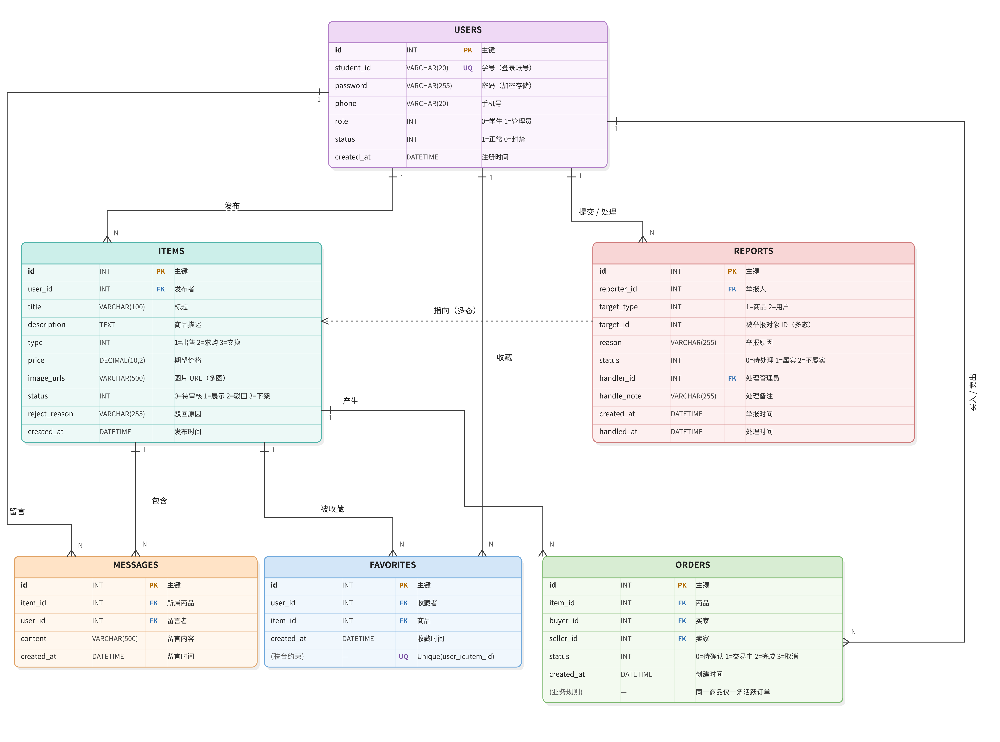
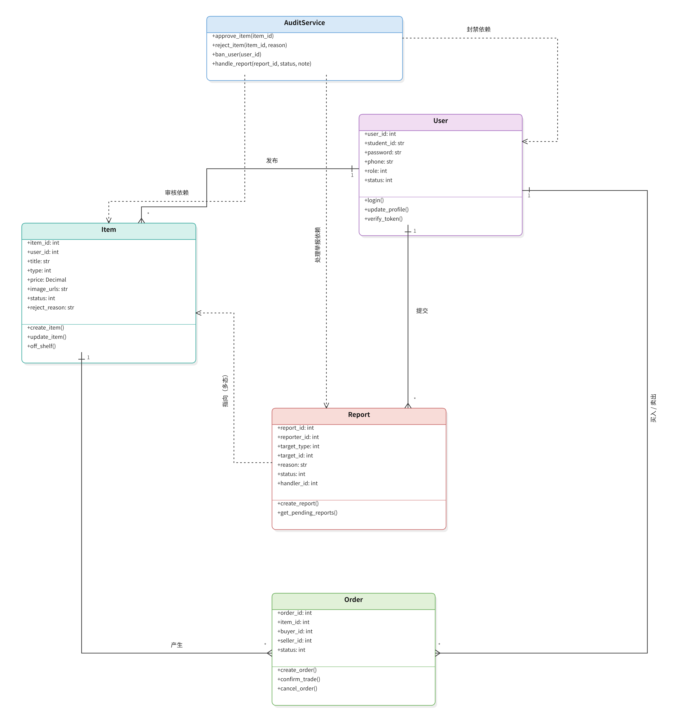
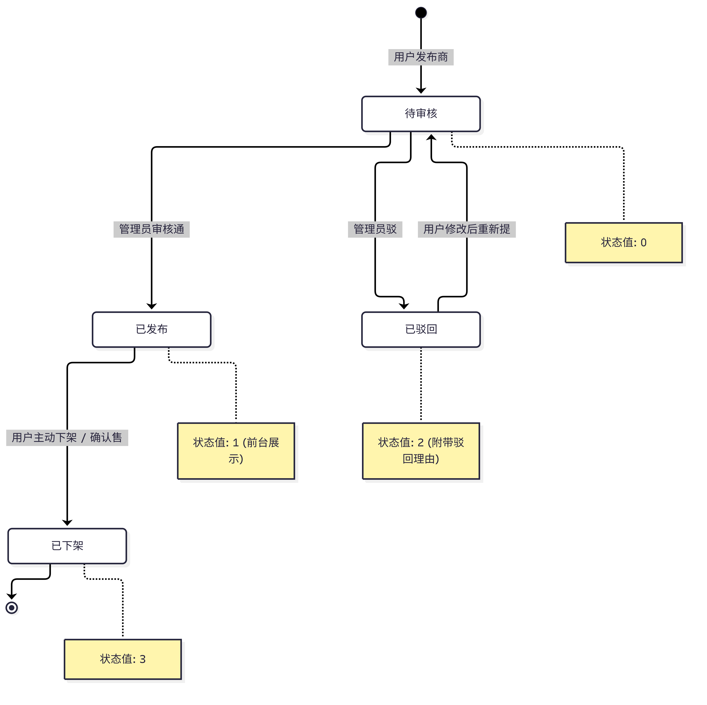

# 第一章 架构设计

## 1.1 系统总体架构概述

本项目“校园闲置物二手置换平台”采用 **B/S（浏览器/服务器）架构**，并严格遵循**前后端分离**的设计思想。  
系统整体分为**展示层、业务逻辑层、数据层**三个核心层级。前端负责页面渲染与用户交互，后端负责核心业务处理与数据持久化，前后端通过 RESTful API 进行数据交互。

## 1.2 分层架构与技术选型

各层级的详细划分与技术选型如下：
1. **展示层（前端）**：
    - **核心框架**：Vue 3 (组合式 API)
    - **UI组件库**：Element Plus（用于快速搭建美观、规范的后台和前台界面）
    - **路由与状态管理**：Vue Router（页面路由跳转）、Pinia（管理用户登录状态、全局配置等）
    - **网络请求**：Axios（封装 HTTP 请求，负责与后端接口通信）
2. **业务逻辑层（后端）**：
    - **核心框架**：FastAPI (Python)
    - **架构模式**：在 FastAPI 中实现 **MVC 的设计变体**，具体划分为：
        - **路由层 (Router/Controller)**：接收前端请求，校验参数，返回响应。
        - **服务层 (Service)**：实现核心业务逻辑（如审核逻辑、状态流转、封禁判断）。
        - **模型层 (Model)**：使用 SQLAlchemy 定义数据表模型。
    - **其他组件**：Pydantic（用于请求/响应数据的严格校验）、Uvicorn（作为ASGI服务器运行FastAPI）。
3. **数据层（数据库）**：
    - **数据库**：MySQL 8.0
    - **交互方式**：后端通过 SQLAlchemy ORM 框架操作数据库，规范数据访问。

## 1.3 系统物理部署图

- **客户端节点**：学生/管理员通过浏览器（Chrome/Edge）访问系统。
- **应用服务器节点（本地）**：
    - **前端服务**：运行 Vite 开发服务器（或本地 Nginx 托管打包文件）。
    - **后端服务**：运行 Uvicorn 服务，承载 FastAPI 应用。
    - **跨域通信**：FastAPI 配置 `CORSMiddleware`，允许前端域名的跨域请求。
- **数据节点（本地）**：运行 MySQL 数据库服务，监听默认端口。

## 1.4 后端业务模块划分

基于系统需求，后端 FastAPI 路由与业务逻辑划分为以下 5 个核心模块：
1. **Auth/User 模块（用户表）**：负责用户注册、登录认证（JWT Token 鉴权）、资料修改、账号封禁拦截。
2. **Item 模块（商品表）**：负责闲置物品的发布（出售/求购/交换）、多图上传及压缩处理、编辑下架、分类与关键字搜索。
3. **Interaction 模块（留言表/收藏表）**：负责商品详情页的留言沟通、用户的收藏/取消收藏功能。
4. **Order 模块（订单表）**：负责生成交易意向订单、状态更新（待交易、已完成等），作为线下凭证。
5. **Admin 模块（商品审核 / 举报表）**：负责后台的商品审核（通过/驳回）、处理用户的举报工单。


# 第二章 数据设计

## 2.1 数据设计概述与规范化原则

本系统采用 MySQL 关系型数据库，使用 SQLAlchemy ORM 进行数据持久化管理。在数据库设计过程中，严格遵循**第三范式（3NF）** 要求：
- 每张表都有一个主键（Primary Key）唯一标识一条记录；
- 所有非主键字段完全依赖于主键，不存在部分依赖；
- 消除传递依赖，即业务表（如商品表、订单表）中仅保留关联表（如用户表）的**外键 ID**，不冗余存储用户的姓名、学号等基础信息，以此降低数据冗余，保证数据的一致性。

## 2.2 E-R 图设计思路

- **实体（矩形）**：用户（User）、商品（Item）、订单（Order）、留言（Message）、收藏（Favorite）、举报（Report）。
- **联系（菱形）**：
    - **发布**：1个用户(1) 可以发布多个商品(N)。
    - **留言**：1个用户(1) 可以发布多条留言(N)，1个商品(1) 可以包含多条留言(N)。
    - **收藏**：1个用户(1) 可以收藏多个商品(N)，1个商品(1) 可以被多个用户收藏(M)。（多对多，在物理表中转化为中间表）。
    - **交易**：1个买家(1) 可以发起多个订单(N)，1个商品(1) 只能对应1个最终生效的订单(1)。
    - **举报**：1个用户(1) 可以提交多条举报(N)；1条举报(1) 只针对1个被举报对象（商品或用户）。

<div align="center">
  
  <div style="color:#999; font-size:14px;">
    E-R 图
  </div>
</div>

## 2.3 核心库表清单

以下为系统的 6 张核心数据表结构设计：

### 表1：用户表（`users`）

|字段名|数据类型|约束|说明|
|---|---|---|---|
|`id`|INT|主键，自增|用户唯一标识|
|`student_id`|VARCHAR(20)|唯一，非空|学号（登录账号）|
|`password`|VARCHAR(255)|非空|密码（需加密存储）|
|`phone`|VARCHAR(20)|可空|手机号（用于找回密码/联系）|
|`role`|INT|默认 0|角色（0=学生/普通用户，1=平台管理员）|
|`status`|INT|默认 1|状态（1=正常，0=封禁）|
|`created_at`|DATETIME|默认当前时间|注册时间|

### 表2：商品表（`items`）

|字段名|数据类型|约束|说明|
|---|---|---|---|
|`id`|INT|主键，自增|商品唯一标识|
|`user_id`|INT|外键，非空|发布者 ID（关联 users 表）|
|`title`|VARCHAR(100)|非空|商品标题|
|`description`|TEXT|可空|商品详细描述|
|`type`|INT|非空|类型（1=出售，2=求购，3=交换）|
|`price`|DECIMAL(10,2)|可空|期望价格（交换/求购可为空或填0）|
|`image_urls`|VARCHAR(500)|可空|图片 URL 地址（多图用逗号分隔或存 JSON）|
|`status`|INT|默认 0|审核状态（0=待审核，1=已通过/展示中，2=已驳回，3=已下架/已售出）|
|`reject_reason`|VARCHAR(255)|可空|驳回原因（仅 `status`=2 时有值，由管理员审核时填写）|
|`created_at`|DATETIME|默认当前时间|发布时间|

### 表3：留言表（`messages`）

|字段名|数据类型|约束|说明|
|---|---|---|---|
|`id`|INT|主键，自增|留言唯一标识|
|`item_id`|INT|外键，非空|所属商品 ID（关联 items 表）|
|`user_id`|INT|外键，非空|留言者 ID（关联 users 表）|
|`content`|VARCHAR(500)|非空|留言内容|
|`created_at`|DATETIME|默认当前时间|留言时间|

### 表4：收藏表（`favorites`）

|字段名|数据类型|约束|说明|
|---|---|---|---|
|`id`|INT|主键，自增|收藏记录唯一标识|
|`user_id`|INT|外键，非空|收藏者 ID（关联 users 表）|
|`item_id`|INT|外键，非空|被收藏的商品 ID（关联 items 表）|
|`created_at`|DATETIME|默认当前时间|收藏时间|
|_(联合约束)_|-|Unique(user_id, item_id)|防止同一用户重复收藏同一商品|

### 表5：订单表（`orders`）

| 字段名          | 数据类型     | 约束     | 说明                            |
| ------------ | -------- | ------ | ----------------------------- |
| `id`         | INT      | 主键，自增  | 订单唯一标识                        |
| `item_id`    | INT      | 外键，非空  | 交易的商品 ID（关联 items 表）          |
| `buyer_id`   | INT      | 外键，非空  | 买家 ID（关联 users 表）             |
| `seller_id`  | INT      | 外键，非空  | 卖家 ID（关联 users 表）             |
| `status`     | INT      | 默认 0   | 订单状态（0=待确认，1=交易中，2=已完成，3=已取消） |
| `created_at` | DATETIME | 默认当前时间 | 订单创建时间                        |
| _(业务约束)_ | - | 同一商品的活跃订单唯一 | 由服务层校验：同一 `item_id` 下 `status` ≠ 3（已取消）的订单只能存在一条，保证“1 个商品只对应 1 个最终生效的订单”。MySQL 不支持部分唯一索引，故不在数据库层添加唯一约束 |

### 表6：举报表（`reports`）

|字段名|数据类型|约束|说明|
|---|---|---|---|
|`id`|INT|主键，自增|举报工单唯一标识|
|`reporter_id`|INT|外键，非空|举报人 ID（关联 users 表）|
|`target_type`|INT|非空|举报对象类型（1=商品，2=用户）|
|`target_id`|INT|非空|被举报对象 ID（按 `target_type` 指向 items 或 users 表；多态关联，不设数据库外键）|
|`reason`|VARCHAR(255)|非空|举报原因|
|`status`|INT|默认 0|处理状态（0=待处理，1=已处理/属实，2=已驳回/不属实）|
|`handler_id`|INT|可空，外键|处理管理员 ID（关联 users 表，待处理时为空）|
|`handle_note`|VARCHAR(255)|可空|处理备注（管理员填写）|
|`created_at`|DATETIME|默认当前时间|举报时间|
|`handled_at`|DATETIME|可空|处理时间|

## 2.4 数据关系模式

- **用户** (`id`, 学号, 密码, 手机号, 角色, 状态, 注册时间)
- **商品** (`id`, 发布者ID, 标题, 描述, 类型, 价格, 图片URL, 状态, 驳回原因, 发布时间)
- **留言** (`id`, 商品ID, 留言者ID, 内容, 留言时间)
- **收藏** (`id`, 用户ID, 商品ID, 收藏时间)
- **订单** (`id`, 商品ID, 买家ID, 卖家ID, 状态, 创建时间)
- **举报** (`id`, 举报人ID, 举报对象类型, 举报对象ID, 举报原因, 处理状态, 处理人ID, 处理备注, 举报时间, 处理时间)


# 第三章 接口设计

## 3.1 接口设计规范与通信协议

本系统前后端通过 **HTTP/HTTPS** 协议进行通信，采用 **RESTful API** 设计风格。
- **数据格式**：请求体与响应体统一采用 `application/json` 格式。
- **鉴权机制（JWT）**：除登录、注册及公开的商品浏览接口外，其余核心接口均需在 HTTP Header 中携带 `Authorization: Bearer <Token>` 进行身份验证。
- **分页规范**：列表类接口统一使用 Query 参数 `page`（当前页）和 `size`（每页条数）进行分页控制。
- **静态资源**：图片上传后由后端保存至本地 `static/uploads/` 目录，并通过 `app.mount("/uploads", StaticFiles(directory="static/uploads"))` 将该目录挂载到 `/uploads` 前缀对外提供访问。二者是“物理目录 → URL 前缀”的映射关系：磁盘路径为 `static/uploads/`，接口返回的相对路径统一以 `/uploads/` 开头（如 `/uploads/img1.jpg`）。

## 3.2 状态码契约

为统一前后端错误处理逻辑，约定以下 HTTP 状态码及业务提示：

|状态码 (Code)|业务含义|前端处理逻辑|
|---|---|---|
|**200 OK**|请求成功|正常解析返回的数据|
|**201 Created**|资源创建成功（如发布商品成功）|提示“操作成功”并刷新页面|
|**400 Bad Request**|请求参数错误或格式校验失败|弹出后端返回的具体错误提示|
|**401 Unauthorized**|未登录或 Token 已过期|清除本地 Token，强制跳转至登录页|
|**403 Forbidden**|无权限操作（如普通用户尝试调用管理员接口，或被封禁用户发帖）|提示“权限不足”或“账号已被封禁”|
|**500 Internal Server Error**|服务器内部错误（如数据库连接断开）|提示“服务器开小差了，请稍后再试”|

## 3.3 核心接口定义

以下为系统各核心业务模块的代表性 RESTful 接口设计：
### 接口1：发布商品

- **功能说明**：用户发布闲置物品（支持多图上传，需先调用图片上传接口获取 URL）。
- **请求 URI**：`POST /api/v1/items/`
- **权限要求**：需登录（学生）
- **请求体 (JSON)**：
``` json
{
  "title": "九成新山地自行车",
  "description": "毕业出，可小刀",
  "type": 1, 
  "price": 150.00,
  "image_urls": ["/uploads/img1.jpg", "/uploads/img2.jpg"]
}
```
- **响应示例 (201 Created)**：
``` json
{ "code": 201, "msg": "发布成功，等待审核", "data": { "item_id": 1024 } }
```

### 接口2：获取商品列表（带分页与搜索）

- **功能说明**：首页展示已审核通过的商品，支持按关键词、分类过滤。
- **请求 URI**：`GET /api/v1/items/?page=1&size=10&keyword=自行车&type=1`
- **权限要求**：公开接口（无需登录）
- **响应示例 (200 OK)**：
```json
{
  "code": 200,
  "msg": "success",
  "data": {
    "total": 56,
    "page": 1,
    "size": 10,
    "list": [
      { "id": 1024, "title": "九成新自行车", "price": 150.00, "cover_url": "/uploads/img1.jpg" }
    ]
  }
}
```

### 接口3：商品审核（管理员）

- **功能说明**：管理员在后台审核用户发布的商品，通过或驳回。
- **请求 URI**：`PUT /api/v1/admin/items/{item_id}/audit`
- **权限要求**：需登录（管理员角色）
- **请求体 (JSON)**：
```json
{
  "status": 1, 
  "reason": "" 
}
(注：status=1 为通过，2 为驳回；驳回时 reason 必填，并写入该商品的 `reject_reason` 字段，供发布者在“我的发布”中查看)
```
- **响应示例 (200 OK)**：
```json
{ "code": 200, "msg": "审核操作成功" }
```

### 接口4：发起交易订单

- **功能说明**：买家确认意向后，生成订单记录。
- **请求 URI**：`POST /api/v1/orders/`
- **权限要求**：需登录（学生）
- **请求体 (JSON)**：
```json
{ "item_id": 1024 }
```
- **响应示例 (201 Created)**：
```json
 { "code": 201, "msg": "订单已发起，请等待卖家确认", "data": { "order_id": 88 } }
```

### 接口5：商品留言

- **功能说明**：买家在商品详情页给卖家留言。
- **请求 URI**：`POST /api/v1/items/{item_id}/messages`
- **权限要求**：需登录（学生）
- **请求体 (JSON)**：
```json
{ "content": "同学你好，车子还在吗？周末能看车吗？" }
```
- **响应示例 (201 Created)**：
```json
{ "code": 201, "msg": "留言成功", "data": { "message_id": 520 } }
```


### 接口6：提交举报

- **功能说明**：用户对违规商品或违规用户提交举报工单。
- **请求 URI**：`POST /api/v1/reports/`
- **权限要求**：需登录（学生）
- **请求体 (JSON)**：
```json
{
  "target_type": 1,
  "target_id": 1024,
  "reason": "商品描述与实际不符，疑似虚假信息"
}
```
(注：target_type=1 举报商品，2 举报用户)
- **响应示例 (201 Created)**：
```json
{ "code": 201, "msg": "举报已提交，请等待管理员处理", "data": { "report_id": 36 } }
```

### 接口7：处理举报（管理员）

- **功能说明**：管理员查看待处理举报并给出结论（属实/不属实），并在处理备注中记录后续处置（如商品下架、用户封禁）。
- **请求 URI**：`PUT /api/v1/admin/reports/{report_id}`
- **权限要求**：需登录（管理员角色）
- **请求体 (JSON)**：
```json
{
  "status": 1,
  "handle_note": "已核实，商品已下架"
}
```
(注：status=1 为属实（已处理），2 为不属实（已驳回）；处理人取当前登录管理员，自动写入 `handler_id` 与 `handled_at`)
- **响应示例 (200 OK)**：
```json
{ "code": 200, "msg": "举报处理成功" }
```

# 第四章 组件设计

## 4.1 核心类设计

系统后端采用面向对象的设计思想，抽象出以下核心类结构：

1. **`User`（用户类）**：
    - **属性**：`user_id`, `student_id`, `password`, `phone`, `role`, `status`。
    - **方法**：`login()`, `update_profile()`, `verify_token()`。
2. **`Item`（商品类）**：
    - **属性**：`item_id`, `user_id`, `title`, `type`, `price`, `image_urls`, `status`, `reject_reason`。
    - **方法**：`create_item()`, `update_item()`, `off_shelf()`。
3. **`Order`（订单类）**：
    - **属性**：`order_id`, `item_id`, `buyer_id`, `seller_id`, `status`。
    - **方法**：`create_order()`, `confirm_trade()`, `cancel_order()`。
4. **`Report`（举报类）**：
    - **属性**：`report_id`, `reporter_id`, `target_type`, `target_id`, `reason`, `status`, `handler_id`。
    - **方法**：`create_report()`, `get_pending_reports()`。
5. **`AuditService`（审核服务类）**：
    - **职责**：专门处理管理员的审核与举报处理业务，不直接与商品数据表耦合，而是通过调用对应的方法实现。
    - **方法**：`approve_item(item_id)`, `reject_item(item_id, reason)`, `ban_user(user_id)`, `handle_report(report_id, status, note)`。

<div align="center">
  
  <div style="color:#999; font-size:14px;">
    UML 类图
  </div>
</div>

## 4.2 核心设计原则应用

- **单一职责原则（SRP）**：在类设计中，`Item` 类只负责维护商品的基础属性（如标题、价格），而将“审核通过”与“驳回”等逻辑抽离到 `AuditService` 类中。确保“数据模型”与“业务逻辑”分离，降低代码耦合度。
- **开闭原则（OCP）**：通过接口继承的方式管理数据库操作（如利用 SQLAlchemy 的 ORM 基类），使系统在不修改原有基础代码的前提下，方便地扩展新字段或增加新功能。

## 4.3 前端组件复用设计

前端基于 Vue3 + Element Plus 构建，采用**组件化开发**，以下为关键复用组件：
1. **`ProductCard.vue`（商品卡片组件）**：
    - **复用场景**：首页列表、搜索结果页、个人中心“我的收藏/我的发布”。
    - **属性参数 (Props)**：接收 `item_id`、`cover_image`、`title`、`price`、`is_favorited` 等。
    - **价值**：一处维护，全站通用，确保UI风格统一。
2. **`ImageUploader.vue`（图片上传组件）**：
    - **复用场景**：发布商品页、编辑商品页。
    - **功能**：封装图片选择、格式校验（限5MB）、自动压缩及向后端请求上传的逻辑。
3. **`Pagination.vue`（分页组件）**：基于 Element Plus 二次封装，统一处理接口调用。
4. **路由守卫（Router Guards）**：在前端路由配置中设置 `beforeEach` 钩子拦截，对于“发布商品”、“我的收藏”等需要权限的页面，未登录用户点击时将直接弹窗引导至登录页面，保障系统安全。

## 4.4 面向过程模块设计

以“商品发布与审核”为例，其业务流程呈现典型的面向过程特征，流转图（**活动图**）如下：
<div align="center">
  
  <div style="color:#999; font-size:14px;">
    流转图
  </div>
</div>

1. **发布阶段**：用户提交发布表单 -> 后端接收 -> 状态初始化为 `0（待审核）`。
2. **审核阶段**：管理员在后台查看待审列表 -> 点击“通过”或“驳回”。
3. **终态**：若通过，状态变更为 `1（已发布）`；若驳回，状态变更为 `2（已驳回）`，并记录驳回原因。
4. **下架**：若用户主动下架或物品已售出，状态变更为 `3（已下架/已交易）`。

## 4.5 设计模式应用说明

针对本系统的业务特征，我们在后端的业务逻辑中引入了以下设计模式：
1. **单例模式（Singleton Pattern）**：
    - **应用场景**：数据库连接池管理（`DatabaseManager` 类）。
    - **说明**：系统启动时初始化数据库连接池，全局保留唯一实例，避免频繁建立/断开连接造成资源损耗，确保后端在高并发下稳定运行。
2. **策略模式（Strategy Pattern）**：
    - **应用场景**：商品发布类型校验（`PublishStrategy`）。
    - **说明**：针对“出售”、“求购”、“交换”三种商品类型，定义不同的校验策略类（如 `SaleStrategy`、`WantBuyStrategy`、`ExchangeStrategy`）。在业务代码中，根据传入的 `type` 动态调用对应的策略类，避免使用大量 `if-else` 判断，提高代码可扩展性。
3. **观察者模式（Observer Pattern）**：
    - **应用场景**：管理员审核通过或买家发起订单时的消息通知。
    - **说明**：将“审核业务”与“消息通知”解耦。当管理员审核通过某商品时，触发“审核通过事件”，通知观察者类（如 `NotificationObserver`）接收到事件后执行通知动作，符合开闭原则；通知渠道以站内信为例，通知表与推送逻辑留待后续迭代实现。


# 第五章 部署设计

## 5.1 部署架构概述

本系统采用**前后端分离**的 B/S 架构，部署设计涵盖“本地开发环境”与“模拟生产环境”两种形态。
- **开发环境**：前端通过 Vite 构建热更新服务，后端使用 Uvicorn 启动 ASGI 服务，连接本地 MySQL 数据库。
- **生产环境（答辩/上线演示）**：前端打包为静态资源交由 Nginx 托管；后端使用 Gunicorn 作为应用服务器；Nginx 作为反向代理服务器，负责接收客户端请求并进行分发（静态文件直接返回，API 接口转发给后端），从而保障系统的高并发与安全性。

## 5.2 软硬件环境与节点规划

- **客户端节点**：学生/管理员使用 PC 或手机浏览器，通过 HTTP/HTTPS 协议访问系统。
- **服务器节点（本地宿主机或云服务器）**：
    - **前端节点**：Nginx 服务器（监听 80/443 端口），托管 Vue3 打包后的 `dist` 静态资源。
    - **后端节点**：Gunicorn 应用服务器（监听 8000 端口），运行 FastAPI 核心代码。
    - **数据节点**：MySQL 8.0 数据库（监听 3306 端口），负责持久化存储。

## 5.3 核心通信路径

1. 浏览器发起请求 →→ **Nginx**。
2. 若请求为静态资源（如 HTML、CSS、JS、上传的图片） →→ Nginx 直接返回。
3. 若请求为 API 业务接口（如 `/api/v1/items`） →→ Nginx 通过反向代理转发给 **Gunicorn (FastAPI)**。
4. FastAPI 处理业务逻辑，通过 SQLAlchemy 从 **MySQL** 读取/写入数据，最后将 JSON 格式的响应逐层返回给浏览器。

## 5.4 部署实施步骤简述

1. **数据库部署**：在本地/服务器安装 MySQL 8.0，创建 `campus_market` 数据库，使用基于 SQLAlchemy 的 Alembic 迁移脚本初始化建表。
2. **后端打包与启动**：
    - 安装 Python 依赖：`pip install -r requirements.txt`
    - 开发模式启动：`uvicorn main:app --reload`
    - 生产环境启动：`gunicorn -w 4 -k uvicorn.workers.UvicornWorker main:app` (启动 4 个 Worker 进程)
3. **前端打包与托管**：
    - 安装依赖：`npm install`
    - 打包静态文件：`npm run build` (生成 `dist` 目录)
    - 将 `dist` 目录放置于 Nginx 的 `html` 目录下，配置 `nginx.conf` 处理前端路由与跨域问题。